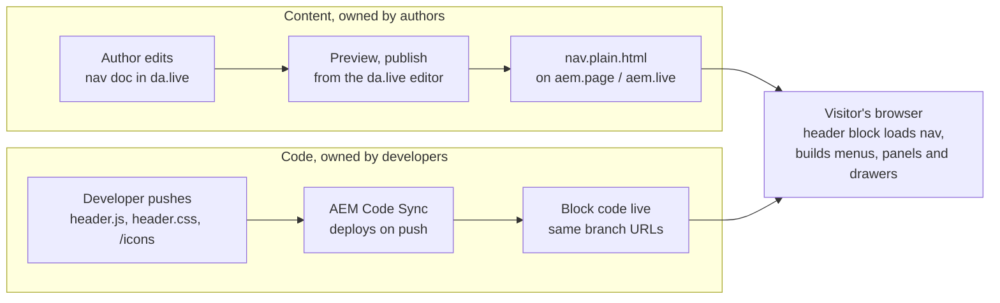

# Cat.com Header on EDS: Implementation Analysis

Oct 13, 2026 · Arka

## Purpose and scope

Recommendation: rebuild the cat.com global header as one EDS `header` block that reads an author-owned `nav` document in Document Authoring (da.live). Authors then change menus, links and drawers without a code deploy. This is an analysis only; no build has started.

**In scope**

- Desktop and mobile header for the North America English site, matching cat.com's layout, colours and interactions
- Search bar, utility links, Sign In, Cat Applications, region and language picker
- Mega menu for Products, Industries, Finance, Support and Company
- Authoring model, icons, design tokens, accessibility and performance targets

**Out of scope**

- Search results page, sign-in and account integration, dealer locator
- Footer, page templates, Cat AI Assistant chat
- Region and language URLs for locales other than North America English

## Current header on cat.com

The header is two black rows on desktop and a black top bar plus search row on mobile, with every menu opening as a white panel or side drawer. Observed on cat.com/en_US on 12 Oct 2026.

| Area | Desktop | Mobile |
| --- | --- | --- |
| Top row | CAT logo, wide search field with a yellow search button, Find Dealer, Sign In, Cat Applications (grid icon) | Hamburger, centred logo, person icon; search field on its own row below |
| Main navigation | Second row: Products, Industries, Finance, Support, Company; Buy Parts and region on the right | Full-screen list with chevrons, Buy Parts, a divider, then Find Dealer, region and Cat Applications |
| Open menu item | Yellow label, chevron up, 4 px yellow bar under the item | Drill-down to the next level |
| Menu panel | White panel below the header: tabs on the left (Equipment, Power Systems, Attachments), links in three columns, side links on the right | Same content, one level per screen |
| Side links | Used Equipment, Rental Equipment, Technology; links to other Cat sites carry an external icon | Same |
| Cat Applications | Drawer from the right: icon, title, description and domain per app, Close button | Full-width drawer |
| Region and language | Drawer: region select, language options with a check on the current one, Save and Cancel | Full-width drawer |
| Colours | Black #000, yellow #ffcd11, white panels | Same |

## Recommended approach

Use the boilerplate's pattern: the `header` block loads the `nav` document as a fragment and turns its lists into the header. Content and code change independently, which is what makes it authorable.

Why this over the alternatives:

- **Hard-coded header in JavaScript**: every link change needs a developer and a deploy.
- **One custom block per menu**: authors would edit block tables, which is harder than nested lists and splits the header across documents.
- **Universal Editor with component models**: possible later, but needs AEM authoring setup; Document Authoring is enough for a list-shaped header.

Files involved: `blocks/header/header.js`, `blocks/header/header.css`, SVGs in `/icons`, one height rule in `styles/styles.css`, and the `nav` document in da.live.

## Authoring model

Authors maintain one `nav` document in da.live with five sections, separated by section breaks, in a fixed order. The header code reads sections by position, so authors must not reorder or delete them.

| # | Section | What authors put in it |
| --- | --- | --- |
| 1 | Brand | Logo image, then a link to the home page |
| 2 | Search | One link to the search results page, for example `/search?q=` (the parameter name is taken from the link) |
| 3 | Tools | Find Dealer link; Sign In and Cat Applications as labels with a nested list, which open drawers |
| 4 | Main navigation | Products, Industries, Finance, Support, Company as labels with nested lists; Buy Parts as a plain link |
| 5 | Region | One label (North America-English) with nested regions, each holding its language links |

Formatting carries behaviour, so authors need no tables or block names:

| Authoring | Result |
| --- | --- |
| Nested list under a menu label | Opens a menu panel |
| Third list level (Equipment, Power Systems) | Becomes a tab inside the panel |
| *Italic* link in a menu | Moves to the side-links column |
| `:pin:`, `:globe:`, `:apps:` | Icon from the `/icons` folder in code |
| **Bold** tools label | Stays in the mobile top bar as an icon (Sign In) |
| *Italic* tools label | Shows only its icon on desktop (Cat Applications) |
| **Bold** link inside a drawer | Button (first one yellow) |
| Link, line break, text inside a drawer | Card with title, description and domain |
| Link to a host other than the home page | External icon, opens in a new window |

A page can point to a different nav document through `nav` page metadata, which allows locale-specific navigation later.

## Component behaviour

The breakpoint is 900 px, the boilerplate default; below it the mobile layout applies.

**Desktop (900 px and wider)**

- Menu items open on click; one panel is open at a time.
- Inside a tabbed panel, the first tab is active on open; hovering, focusing or clicking another tab switches it.
- A click outside the header, tabbing out of it, or Escape closes the panel. Escape returns focus to the menu item.
- Tools labels open drawers; links go straight to their page.

**Mobile (below 900 px)**

- The hamburger opens a full-screen menu and locks page scrolling; the search row hides.
- Each level slides over the previous one with a back row at the top (Products, then Equipment, then its links).
- Escape goes back one level, then closes the menu.
- Sign In stays in the top bar as an icon.

**Drawers (both)**

- Built on the native `dialog` element: it traps focus, Escape closes it, and focus returns to the opener.
- A click on the dimmed backdrop closes it.
- The region picker shows the languages of the selected region; Save goes to the chosen language's URL, Cancel closes.
- 480 px wide on desktop, full width on mobile; slides in from the right unless the user prefers reduced motion.

## Styling

All header colours and sizes live as CSS custom properties at the top of `header.css`, scoped to `header`, so a theme change is one edit. Sizes are estimated from screenshots, not measured from cat.com's stylesheet.

| Token | Value | Used for |
| --- | --- | --- |
| `--header-black` | #000 | Header rows, text on white |
| `--header-yellow` | #ffcd11 | Search button, open item, active tab, primary buttons |
| `--header-white` | #fff | Panels, drawers, search field |
| `--header-line` | #d9d9d9 | Dividers on white |
| `--header-line-dark` | #333 | Line between the two desktop rows |
| `--header-link` | #0067b8 | Domains and text links in drawers (assumed) |
| `--header-bar-height` | 64 px mobile, 88 px desktop | Top row |
| `--header-nav-height` | 44 px | Desktop main navigation row |
| `--header-search-height` | 44 px | Search field and button |

- **Fonts**: the boilerplate's self-hosted Roboto for text and Roboto Condensed for drawer titles. cat.com's body text appears to be Noto Sans; matching it means adding self-hosted Noto Sans files to `/fonts`.
- **Icons**: SVG files in `/icons`, drawn through a CSS mask so they take the text colour (white on black, black on white). 14 icons are needed: search, pin, person, apps, globe, external, close, settings, cart, box, tag, clock, truck, dollar. Open-source sets (Material Icons, Apache 2.0; Feather, MIT) cover them; the client's own icon set should replace them if one exists.
- **Logo**: the client's logo image, placed by authors in the brand section.

## Accessibility, performance and quality gates

The header must not cost the page its Lighthouse 100, and must be usable by keyboard and screen reader alone.

**Accessibility**

- Menu items and tabs are real buttons with `aria-expanded` and `aria-controls`; drawers are labelled dialogs.
- Visible focus outline on every link and button; the search field and icon-only buttons have accessible names.
- External links announce "opens in a new window" to screen readers.
- Text on black and yellow meets WCAG AA contrast (black on #ffcd11, white on #000).

**Performance**

- The header loads after the page's largest content, as the boilerplate does, so it does not delay LCP.
- Reserve the header height in `styles/styles.css` (120 px mobile, 133 px desktop) to avoid layout shift when it renders.
- No libraries; icons are small SVG files fetched on demand.

**Quality gates before release**

- [ ] `npm run lint` passes (ESLint and Stylelint, boilerplate rules)
- [ ] Lighthouse mobile and desktop at 100 on a page with the header
- [ ] Keyboard-only walkthrough of every menu, tab and drawer
- [ ] Screen reader check (NVDA on Windows, VoiceOver on iOS)
- [ ] Chrome, Edge, Safari and Firefox at 375, 900, 1280 and 1920 px

## Delivery plan

Rough estimate: about 12 developer-days for one frontend developer, plus author review time. These are planning estimates, not commitments.

| Phase | Work | Estimate (days) |
| --- | --- | --- |
| 1. Authoring contract | Agree the five-section nav document and formatting rules with authors; create the first `nav` document in da.live | 1 |
| 2. Header shell | Two-row desktop and mobile top bar, logo, search form, tools links, design tokens | 2 |
| 3. Menu panels | Desktop panels with tabs and side links; mobile drill-down with back rows | 3 |
| 4. Drawers | Sign In, Cat Applications cards, region and language picker | 2 |
| 5. Icons and fonts | Icon set in `/icons`; fonts if Noto Sans is required | 1 |
| 6. Quality | Accessibility, Lighthouse, cross-browser and device checks; fixes | 2 |
| 7. Handover | Author guide for the nav document; developer notes | 1 |

Phases 2 to 4 can be demoed to authors after each one, so feedback lands before the quality phase.

## Risks, gaps and open questions

**Risks**

| Risk | Impact | Mitigation |
| --- | --- | --- |
| Authors reorder or delete nav sections | Header renders in the wrong places | Author guide; a later version can name sections with Section Metadata instead of position |
| The current boilerplate does not process Section Metadata | Named sections need extra code | Keep positional sections for version 1 |
| Icon shortcodes (`:pin:`) or external logo images not converted on preview | Missing icons or logo | Check `nav.plain.html` after the first preview; place the logo image directly in da.live |
| Styles estimated from screenshots | Small visual differences from cat.com | Get the design specs or the current header CSS values from the Cat team |
| Header height grows from 64 px to 133 px | Layout shift on load | Reserve the height in `styles/styles.css` |

**Open questions**

- [ ] Which search results page and query parameter should the search form use?
- [ ] What are the region and language URLs beyond North America English?
- [ ] Should Sign In link to the existing account pages, or integrate with the identity provider?
- [ ] Is Noto Sans required, or is the boilerplate font acceptable?
- [ ] Is there an official Cat icon set to use instead of open-source icons?
- [ ] Should external links open in a new window, as the icon suggests?
- [ ] Who owns the `nav` document in da.live, and who can publish it?
